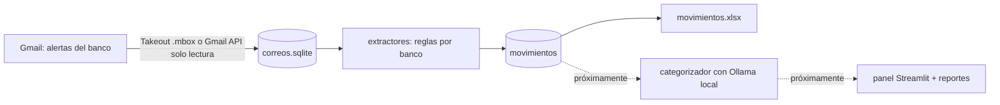

# Expense-control-friend

Herramienta local en Python que registra tus gastos automáticamente a partir de los correos de alerta de tus bancos, sin digitarlos a mano, y los deja listos para analizar hábitos (gastos hormiga, suscripciones, presupuesto).

*A local Python tool that builds an expense log from your bank's email alerts (Gmail) and statements, with no manual entry. Rules extract the amounts; a local model via Ollama will handle categorisation and reports. Nothing leaves your computer.*

> Estado: en desarrollo. Ya funciona la descarga de correos, la extracción de movimientos y los reportes en Excel. Faltan los estados de cuenta en PDF, el categorizador, el panel web y el agente de análisis.

## Cómo funciona



- **Reglas primero, IA después.** Monto, fecha y comercio salen de expresiones regulares probadas con pytest. Un modelo local (Ollama) solo interpreta lo que las reglas no cubren y redacta los reportes; los cálculos los hace Python.
- **Configuración como datos.** Bancos, dominios oficiales, asuntos a ignorar y palabras clave viven en [`config/bancos.toml`](config/bancos.toml). Agregar un banco es, en buena parte, editar ese archivo y escribir su lector.
- **Privacidad.** Todo corre en tu computadora. Gmail se lee con permiso de solo lectura y el token se guarda en el Administrador de credenciales de Windows (keyring). Solo se procesan correos de dominios oficiales de los bancos, y se marca cualquiera que no pase DKIM/SPF.

Bancos soportados hoy (Costa Rica): **BAC**, **Banco Nacional (BNCR)** y **Davibank** (antes Scotiabank).

## Instalación

Requiere Python 3.11 o más reciente (usa `tomllib`). Probado en Windows.

```bat
git clone https://github.com/Frederikfor/Expense-control-friend.git
cd Expense-control-friend
python -m venv .venv
.venv\Scripts\activate
pip install -r requirements.txt
```

Para la Gmail API necesitas un proyecto en Google Cloud (gratis, sin facturación) con la Gmail API activada y un cliente OAuth de tipo "Aplicación de escritorio". Descarga su JSON y guárdalo **fuera del repositorio** (o como `client_secret.json` en la raíz, que está en `.gitignore`).

## Uso

Todos los comandos se corren desde `scripts/` con el entorno activado. Si no pones `--salida`, se usa la carpeta `datos/` junto a `scripts/`. Cada corrida deja su log y sus resultados en una carpeta nueva con fecha y hora.

```bat
REM 1) Importar el historial desde un .mbox de Google Takeout
python leer_mbox.py "C:\ruta\a\Takeout\Correo\Bancos.mbox"

REM 2) Traer lo nuevo con la Gmail API (la primera vez abre el navegador para autorizar)
python sincronizar_gmail.py --credenciales "C:\ruta\a\client_secret.json"
REM    Recuperar un periodo de un remitente específico
python sincronizar_gmail.py --credenciales "C:\ruta\a\client_secret.json" --consulta "from:notificacionbac@baccredomatic.cr" --desde 2025-10-01

REM 3) Sacar los movimientos y generar movimientos.xlsx
python procesar_correos.py

REM 4) Ejemplos anonimizados (dígitos a 9, nombres tapados) para diseñar lectores nuevos
python muestras_anonimas.py --ocultar "Nombre,Apellido1,Apellido2"

REM 5) Pruebas
python -m pytest tests
```

Atajo: `actualizar.bat` en la raíz hace los pasos 2 y 3 con doble clic. Toma la ruta del JSON de la variable de entorno `CREDENCIALES`, que se configura una vez con `setx CREDENCIALES "C:\ruta\a\client_secret.json"`.

## Estructura

| Ruta | Qué hace |
|---|---|
| `scripts/leer_mbox.py` | Importa un .mbox de Takeout a SQLite y extrae los PDF/XML adjuntos. |
| `scripts/sincronizar_gmail.py` | Sincronización incremental con la Gmail API (solo lectura, deduplica por Message-ID). |
| `scripts/extractores.py` | Lectores puros por banco que devuelven un `Movimiento`. |
| `scripts/configuracion.py` | Carga y valida `config/bancos.toml`. |
| `scripts/procesar_correos.py` | Aplica los lectores y genera las tablas y el Excel de resultados. |
| `scripts/muestras_anonimas.py`, `scripts/muestras_pdf.py` | Muestras anonimizadas de correos y de PDF. |
| `scripts/tests/` | Pruebas con pytest sobre correos de ejemplo inventados. |

## Tus datos no van al repositorio

`.gitignore` excluye `datos/`, estados de cuenta, `.mbox`, bases SQLite, Excel, PDF, logs y cualquier JSON de credenciales. Antes de hacer un commit, revisa `git status`. Si usas OneDrive o Dropbox, considera guardar `datos/` fuera de la carpeta sincronizada con `--salida`.

## Hoja de ruta

1. Lector de estados de cuenta en PDF (validando saldo inicial + movimientos = saldo final).
2. Conciliación entre estado de cuenta y alertas de correo.
3. Categorizador: reglas comercio→categoría, con Ollama local como respaldo.
4. Panel local en Streamlit y agente de análisis de hábitos.

## Licencia

[MIT](LICENSE)
